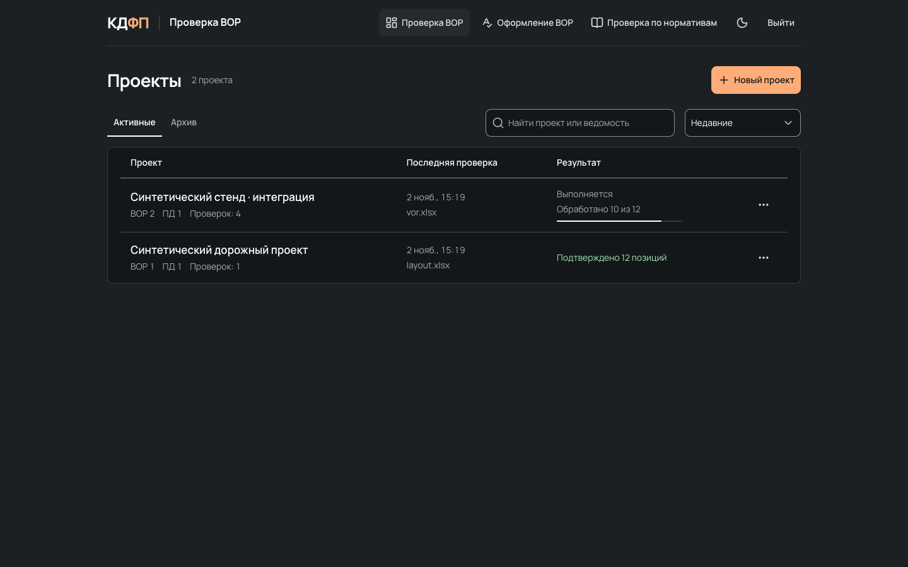

# Проверка ВОР и проектной документации

smeta-checker помогает сметчику проверить ведомость объёмов работ (ВОР) по проектной документации (ПД). Приложение сопоставляет позиции с загруженными документами, показывает найденные источники и возможные расхождения, а затем формирует отчёт Word. Выводы предназначены для проверки специалистом, а не для автоматического принятия инженерного решения.



Список проектов в работающем интерфейсе; данные на снимке синтетические.

[Быстрый запуск](#быстрый-запуск) · [Использование](#использование) · [Ограничения](#ограничения) · [Документация](#документация) · [Разработка](#разработка)

## Возможности

- Проекты, документы и их редакции с историей проверок.
- Загрузка ВОР в XLSX или CSV и проектной документации в PDF, предварительная проверка комплекта.
- Сопоставление позиций ВОР с ПД и отдельный нормативный этап; просмотр результатов, источников и страниц PDF.
- Проверка оформления XLSX по набору правил и выгрузка отчётов.
- Word-отчёт по результатам аудита и доступ к исходным документам.

## Использование

1. Создайте проект и загрузите ВОР и ПД. При загрузке укажите, создаётся новый документ или редакция существующего.
2. Откройте ведомость, запустите проверку и ознакомьтесь с результатом предварительной проверки комплекта.
3. В результатах откройте позицию: сравните данные ВОР с найденными страницами и цитатами ПД, проверьте замечания и нормативные ссылки.
4. Скачайте Word-отчёт. При необходимости вернитесь к сохранённой проверке и исходным редакциям документов.

Подробности о работе с проектами, редакциями и результатами: [руководство по интерфейсу](frontend/README.md#пользовательский-цикл).

## Ограничения

- Результаты модели и найденные цитаты требуют проверки инженером: совпадение текста или числа само по себе не доказывает применимость к работе. Ошибки распознавания сканов, сложные таблицы, неполный комплект и ограниченный контекст могут оставить проверку незавершённой.
- Нормативные данные распространяются отдельно от исходного кода. Доступ к архивам и их установка необходимы для стандартного запуска Compose. Состав корпуса не гарантирует полноту или актуальность нормативов; редакцию и применимость норм проверяет специалист.
- Для аудита нужен доступ к настроенному провайдеру языковой модели (LLM). Запросы могут расходовать квоту и передавать провайдеру фрагменты документов. Перед загрузкой убедитесь, что такая обработка разрешена.
- Проверка оформления использует набор правил приложения; она не подтверждает полное соответствие XML-схеме или нормативным требованиям.

## Быстрый запуск

### Подготовка

Нужны Git, Docker с Compose, Python 3.12 или новее и [GitHub CLI](https://cli.github.com/). Для скачивания проекта и нормативных архивов нужна учётная запись GitHub с доступом к приватному репозиторию и его релизам. Docker Desktop должен быть запущен; на Linux нужны Docker Engine и плагин Compose.

Клонируйте репозиторий и установите нормативные данные из корня проекта:

```sh
git clone https://github.com/KDFP-IT/smeta-checker.git
cd smeta-checker
git checkout dev
gh auth login
python3 scripts/install-normative-data.py
```

В Windows PowerShell используйте `python` вместо `python3`. Установщик скачивает архивы приватного релиза, проверяет SHA-256 и не перезаписывает существующие каталоги `base/` и `normative-handoff-20261030-092929/`. Для повторного запуска используйте уже установленные данные; не удаляйте их без необходимости.

Создайте файл настроек в корне проекта:

```sh
cp .env.example .env
```

В Windows PowerShell вместо этой команды: `Copy-Item .env.example .env`. Откройте `.env` и задайте:

- `POSTGRES_PASSWORD` и случайный `AUDIT_API_TOKEN`;
- `WORKSPACE_LOGIN` и `WORKSPACE_PASSWORD` для входа в режиме `local` по умолчанию;
- для аудита настройки одного провайдера: `YANDEX_CLOUD_API_KEY` и `YANDEX_CLOUD_FOLDER`, либо `ANYMODEL_API_KEY` и `ANYMODEL_MODEL`, либо `ROUTERAI_API_KEY` и `ROUTERAI_MODEL`.

Храните реальные пароли и ключи только в игнорируемом `.env` или защищённом окружении, не в Git. Корпоративный вход Active Directory настраивается отдельно в [инструкции по запуску](docs/docker-quickstart.md#вход-два-режима-без-анонимного-доступа).

### Запуск

```sh
docker compose up -d --build
docker compose ps
```

После запуска откройте [http://127.0.0.1:3000](http://127.0.0.1:3000) и войдите с `WORKSPACE_LOGIN` и `WORKSPACE_PASSWORD`. Сервис `migrate` применяет миграции и успешно завершается; остальные сервисы продолжают работать. Если порты, нормативные данные или вход настроены иначе, см. [подробную инструкцию](docs/docker-quickstart.md).

Интерфейс по умолчанию доступен только на локальном адресе, но порт API в текущем Compose публикуется без ограничения интерфейса хоста. Ограничьте доступ к API сетевым экраном; для доступа из сети настройте защиту и TLS согласно [инструкции](docs/docker-quickstart.md).

## Документация

- [Установка, вход, сетевой доступ и диагностика](docs/docker-quickstart.md).
- [Версии нормативных данных и установка из Releases](docs/normative-data.md).
- [Резервное копирование, перенос и восстановление данных](docs/data-migration.md).
- [Развёртывание и обновление](docs/deployment-cicd.md); [мониторинг](docs/monitoring.md).
- [API и ограничения доступа](docs/api.md); [среда разработки и проверки](docs/development.md).
- [Работа с документами и проверки интерфейса](frontend/README.md).
- [Привязка PDF](docs/pdf-bindings.md), [проверка человеком и доказательства](docs/human-evidence.md), [возобновление аудитов](docs/resumable-audits.md).
- [Нормативный этап и его ограничения](docs/normative-agent-pipeline.md).

## Разработка

Компоненты: браузер → веб-интерфейс Nuxt → API FastAPI → PostgreSQL и файловое хранилище. Redis и фоновые обработчики выполняют подготовку документов и проверки. API-токен хранится на сервере интерфейса, а не в браузере.

Поддерживаемый запуск приложения описан выше и использует Docker Compose. Отдельный сервер интерфейса и синтетический backend применяются для разработки и проверки, а не как замена инструкции развёртывания.

- [Frontend: окружение, генерация API-контрактов и проверки](frontend/README.md#контракты-и-проверки).
- Backend: Python 3.14 и `uv`; команды из `backend/`: `uv sync --frozen`, `uv run pytest`, `uv run ruff check .`, `uv run pyright`.
- Интерактивная спецификация API доступна у запущенного сервиса по `/docs`; доступ к API и его порту необходимо ограничить.
